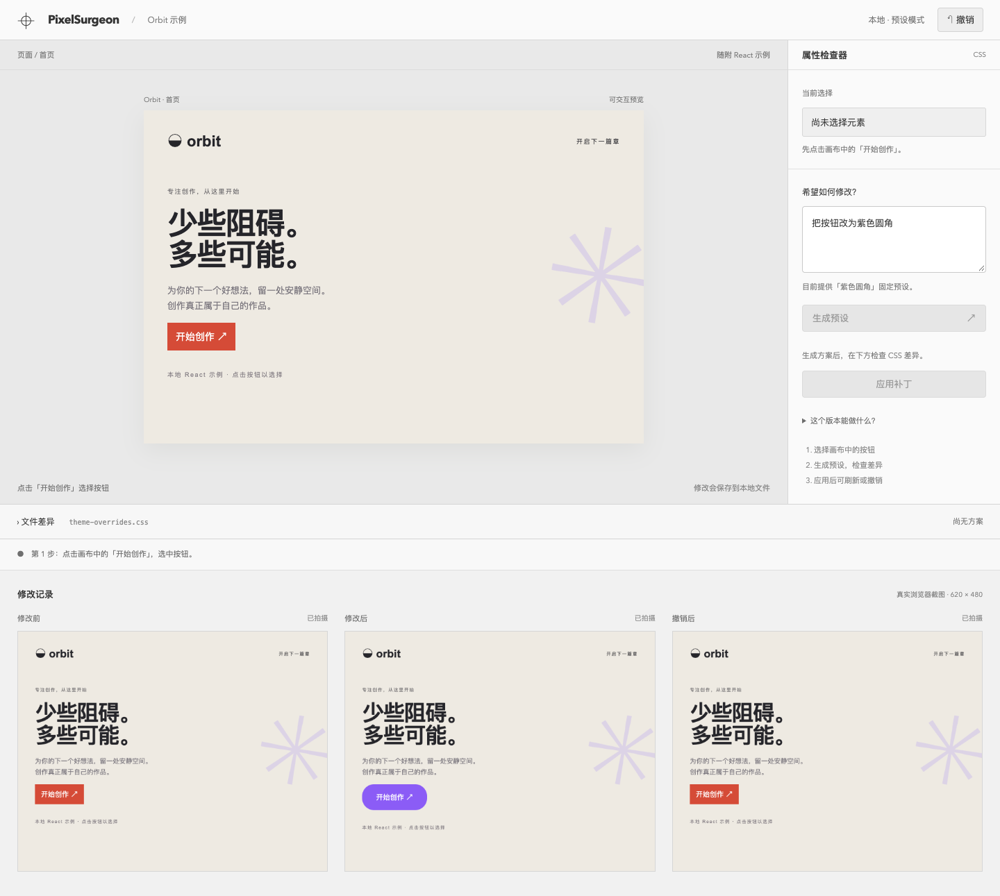
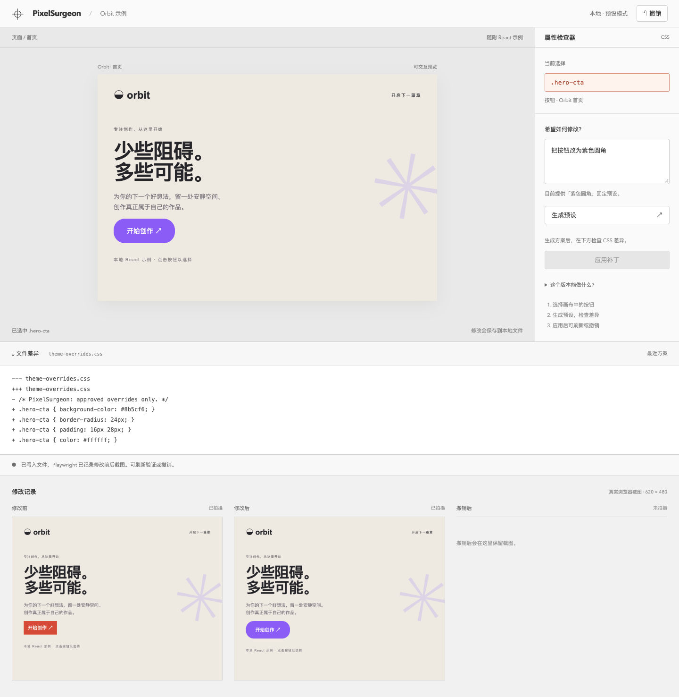

# 使用手册 · PixelSurgeon

一个本地 CSS 修改实验台，适合想看清「页面上的按钮怎么对应到文件修改」的前端开发者。左侧是可交互页面，右侧填写修改要求，底部展开文件差异。应用后可以刷新验证，也可以撤销。

目前只做通了一条流程：把随附 Orbit 示例的按钮改成紫色圆角。**没有接入 AI，输入由固定规则解析，项目状态为 PARTIAL。**



## 启动

需要 Node.js 22.12+（22.x）、24.x 或 26+ 和 npm。在本项目目录执行：

```sh
npm run setup
npm run doctor
npm run dev
```

打开 [本地编辑器](http://127.0.0.1:4203)。终端保持运行，按 Ctrl+C 停止。API 使用 5203 端口，两个服务都只监听 `127.0.0.1`。

`setup` 按锁文件安装依赖，再安装 Chromium 到项目的 `.browsers/`；已存在匹配版本时直接复用。`doctor` 检查 Node、依赖、浏览器和端口，缺项时给出中文建议。Windows PowerShell、cmd 和 macOS/Linux 终端使用相同 npm 命令。本次只在 macOS / Node.js 26.4.0 实测，未验证 Windows、Linux 或空缓存首次下载。

## 试一次修改

1. 点击画布里的「开始创作」，选中 `.hero-cta`。
2. 保留「把按钮改为紫色圆角」，点击「生成预设」，查看下方 CSS 差异。此时文件还没改。
3. 点击「应用补丁」。按钮变为紫色圆角，下面出现真实的修改前后截图。
4. 刷新页面，效果仍在；点击顶部「撤销」，恢复原来的 CSS。



这两张图来自运行中的应用。截图、文件修改和撤销都由实际流程产生。

## 能改到哪里

唯一可写的源文件是 `fixtures/demo-site/src/theme-overrides.css`，唯一可选元素是 `.hero-cta`。后端拒绝任意路径、选择器、脚本和命令；属性和值也有白名单。预设方案五分钟后失效，文件在此期间变化也需要重新生成方案。

应用前会保存一份 CSS 快照，撤销只支持这一份。截图和快照保存在 `artifacts/`，刷新后仍可读取。若写文件后截图失败，修改可能已经生效；先修复浏览器或服务，再刷新或撤销。服务停止后可以清理 `artifacts/`，但撤销记录和截图也会一起丢失。

当前没有任意网站导入、真实模型推理、视觉评分、多级历史或生产部署入口。不需要账号、API Key、数据库或 Docker。

## 开发与验证

React / Vite 提供界面和示例页面，Express 处理本地文件，Zod 验证请求，Playwright 截图和测试。依赖版本以 `package-lock.json` 为准。

先停止手动启动的服务，再运行：

```sh
npm run build
npm run test
npm run e2e
npm run demo
```

测试检查真实磁盘写入、计算样式、前后截图不同、刷新持久化、撤销恢复，以及路径和请求校验。界面验收覆盖 1440 × 900 桌面、390 像素小屏、键盘焦点、空状态、错误恢复、处理中反馈与差异抽屉。

演示会生成 `artifacts/demo-before.png`、`artifacts/demo-after.png`、`artifacts/demo-undo.png` 和 `artifacts/playwright/demo/` 下的录屏。README 配图保存在 `docs/images/` 并提交到 Git；其他运行产物不提交。实际验证结果见 `status.json`。

缺依赖时重新执行 `npm run setup`；只缺浏览器可运行 `npm run browser:install`。端口冲突时先停止旧服务，再运行 `doctor`。本项目已在运行时，doctor 报端口占用属于正常现象。Linux 缺系统浏览器库时需另行安装，本项目脚本不安装系统包。

MIT 许可，见 [LICENSE](../LICENSE)。
